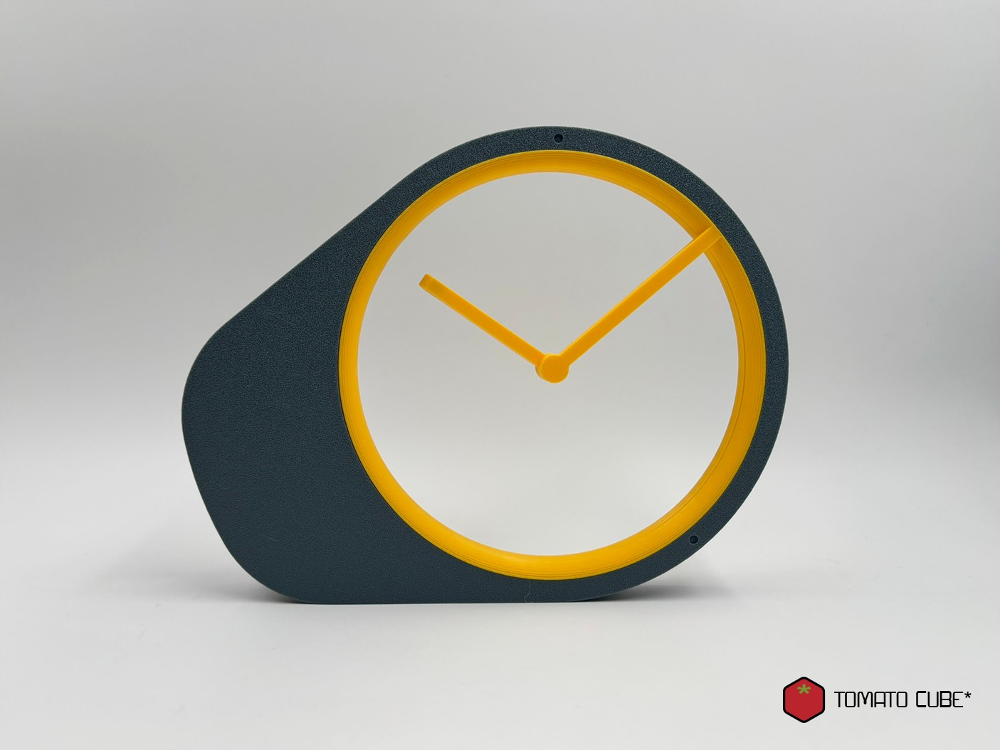
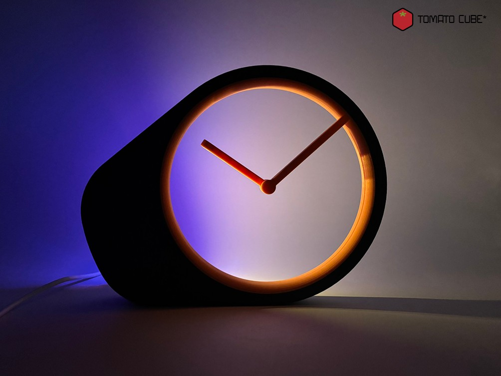
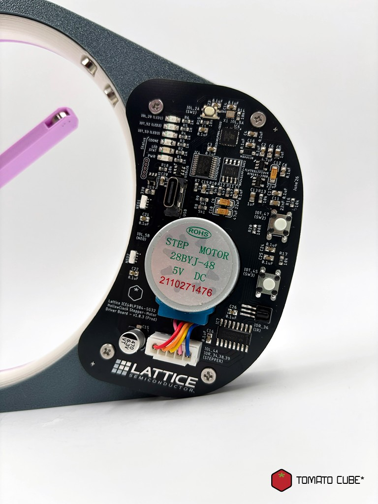

# iCE40LP384 HollowClock Controller Board

## (a) Description

This PCB is the controller board for the TomatoCube HollowClock Lab Kit (iCE40 FPGA edition), built around the Lattice iCE40LP384 FPGA. It drives the HollowClock's 28BYJ-48 stepper motor to turn the clock hands, and includes an infrared (IR) receiver for remote control, two NeoPixels RGB lighting output, tactile buttons and LEDs. Users can explore digital logic and hardware design by writing and building their own Verilog with the open-source apio toolchain.


## (b) Features


## (c) Instructions - Installing the apio CLI

The HollowClock firmware is built with **apio**, an open-source command-line toolchain for iCE40 FPGAs (it bundles Yosys, nextpnr and IceStorm).

1. Install **Python 3** (3.9 or newer) from [python.org](https://www.python.org/downloads/) if you don't already have it.
   * Windows: tick **Add Python to PATH** during installation.
2. Open a terminal (Command Prompt / PowerShell on Windows, Terminal on macOS/Linux) and install apio:
   ```
   pip install -U apio
   ```
3. Install the FPGA toolchain packages:
   ```
   apio packages install
   ```
   *(Older apio 0.9.x versions use `apio install --all` instead.)*
4. Check that everything is ready:
   ```
   apio --version
   ```


## (d) Firmware

The HollowClock firmware (Verilog source) is available on GitHub:
👉 [HollowClock Firmware](/software/verilog)

```
/software/verilog
```

1. Download the firmware folder (click **Code → Download ZIP** and unzip it, or `git clone` the repository).
2. Open a terminal inside the firmware folder (the one containing `apio.ini`).
3. Build the bitstream:
   ```
   apio build
   ```
4. Connect the HollowClock Controller Board to your computer with a USB cable. It appears as a USB drive.
5. Copy the generated `hardware.bin` onto the board's drive.
   *(With apio 1.x the file is in the `_build/default/` folder.)*
6. Wait for the copy to finish. The board loads the new firmware and the clock starts running.


## (e) Showcase






